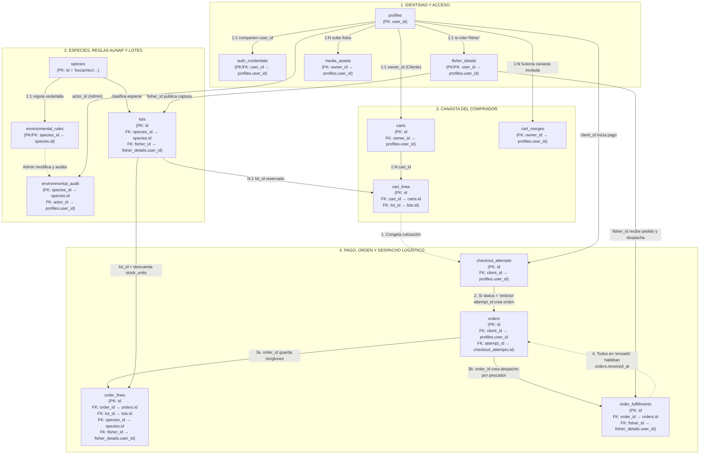
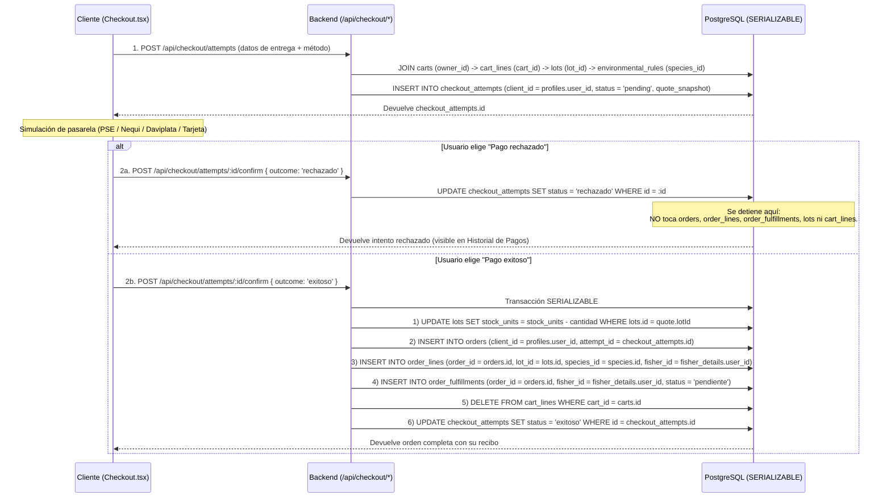

# Raíz del Río — Documentación del Backend y Base de Datos PostgreSQL (`server/`)

Este documento explica la arquitectura del backend (`server/` + `app/api/`), la función exacta de cada una de las **15 tablas** de PostgreSQL (`raiz_del_rio`) y cómo fluye la información entre ellas durante el registro, la publicación de capturas, el armado de la canasta, el proceso de pago (checkout), la creación de órdenes y el despacho logístico por familia pescadora.

---

## 1. ¿Por qué existen 15 tablas? (Diccionario de Tablas por Módulo)

El esquema `public` de PostgreSQL consta de **15 tablas** divididas en **4 dominios funcionales**:

### Bloque A — Usuarios, Perfiles y Credenciales (4 tablas)

| Tabla | ¿Qué función cumple? | Relaciones clave |
| :--- | :--- | :--- |
| **`profiles`** | **Tabla maestra de usuarios.** Guarda toda persona registrada en la plataforma sin importar su rol (`client`, `fisher` o `admin`), junto con su nombre, teléfono, dirección de entrega y preferencias de accesibilidad (`text_size`, `read_instructions`). | PK: `user_id` (UUID). Es la tabla padre de casi todo el sistema. |
| **`auth_credentials`** | **Credenciales de acceso.** Guarda el correo único (`email`), la sal (`password_salt`) y el hash criptográfico `scrypt` (`password_hash`) de la contraseña o del PIN de 4 dígitos. Se separa de `profiles` por seguridad para que las consultas de perfil nunca expongan hashes de contraseñas. | PK/FK: `user_id` → `profiles(user_id)`. |
| **`fisher_details`** | **Extensión exclusiva del Pescador Artesanal.** Solo los usuarios con `role = 'fisher'` tienen fila aquí. Guarda su apodo (`nickname`, ej. *Don José*), cédula (`document`), puerto base (`port`), código de afiliación FEDEPESAN (`member_code`, ej. `FP-0018`) y foto de perfil (`photo_id`). | PK/FK: `user_id` → `profiles(user_id)`. |
| **`media_assets`** | **Catálogo opcional de metadatos de archivos.** Diseñada para registrar metadatos de imágenes (propietario, propósito, tamaño en bytes, dimensiones y ruta) cuando se integran buckets de almacenamiento. | FK: `owner_id` → `profiles(user_id)`. |

---

### Bloque B — Especies, Control Ambiental AUNAP y Lotes de Pesca (4 tablas)

> **Regla de oro del dominio:** **Especie ≠ Lote ≠ Pescador.** Una especie (ej. *Bocachico*) es la definición biológica; un lote (`lots`) es una captura específica pescada hoy por un pescador específico con un peso, precio y talla propios.

| Tabla | ¿Qué función cumple? | Relaciones clave |
| :--- | :--- | :--- |
| **`species`** | **Catálogo biológico de las 6 especies del río Magdalena** (`bocachico`, `rayado`, `pintado`, `nicuro`, `dorada`, `blanquillo`). Guarda nombre común, nombre científico, descripción culinaria, color de ilustración, precio sugerido por kg y talla mínima de referencia. | PK: `id` (texto, ej. `'bocachico'`). |
| **`environmental_rules`** | **Reglas ambientales vigentes (Panel Admin AUNAP).** Tiene 1 fila por especie. Define si la especie está actualmente en **veda** (`banned = true/false`), cuál es su **talla mínima legal activa** (`minimum_length_cm`) y si está activa la **simulación educativa de talla insuficiente** (`simulated_length_cm = 22`). Incluye `version` para bloqueo optimista. | PK/FK: `species_id` → `species(id)`. |
| **`environmental_audit`** | **Bitácora de auditoría ambiental.** Cada vez que el Administrador activa/desactiva una veda o cambia una talla mínima en `environmental_rules`, se inserta aquí un registro histórico inmutable con quién hizo el cambio (`actor_name`), cuándo (`occurred_at`), el estado anterior (`previous_state`) y el nuevo (`next_state`). | FK: `species_id` → `species(id)`, `actor_id` → `profiles(user_id)`. |
| **`lots`** | **Inventario vivo de capturas publicadas en la tienda.** Cada vez que un pescador completa el asistente de 5 pasos ("Registrar nueva pesca"), se crea una fila aquí. Guarda cuántos kilos o peces quedan disponibles (`stock_units`), precio por kg (`price_per_kg_cop`), peso por pieza si aplica (`piece_weight_grams`), talla medida (`length_cm`), zona, arte de pesca, horas de captura/desembarque, temperatura, foto, si está pausado (`paused`) o retirado (`withdrawn_at` para baja lógica sin romper recibos antiguos). | PK: `id` (UUID). FK: `species_id` → `species(id)`, `fisher_id` → `fisher_details(user_id)`. |

---

### Bloque C — Canasta de Compras (3 tablas)

| Tabla | ¿Qué función cumple? | Relaciones clave |
| :--- | :--- | :--- |
| **`carts`** | **Cabecera de la canasta privada de cada comprador.** Cada cliente tiene una única canasta activa asociada a su `owner_id`. Posee un contador `version` que sube en cada cambio para evitar que el usuario pague una canasta desactualizada si tenía dos pestañas abiertas. | PK: `id` (UUID). FK única: `owner_id` → `profiles(user_id)`. |
| **`cart_lines`** | **Productos dentro de la canasta.** Cada fila representa un lote (`lot_id`) agregado a la canasta (`cart_id`) y la cantidad de kilos o peces (`quantity`). Cuando el cliente vacía su canasta o completa una compra, estas filas se eliminan. | FK: `cart_id` → `carts(id)`, `lot_id` → `lots(id)`. |
| **`cart_merges`** | **Registro de fusión de canasta de invitado.** Si un visitante arma una canasta sin iniciar sesión y luego entra a su cuenta de cliente, el frontend llama a `POST /api/cart/merge`. Esta tabla guarda el `merge_id` para garantizar **idempotencia** (que la canasta invitada se sume una sola vez y nunca se duplique por reintentos de red). | FK: `owner_id` → `profiles(user_id)`. |

---

### Bloque D — Pagos (Intentos), Órdenes Confirmadas y Despacho Logístico (4 tablas)

Aquí suele surgir la duda principal: **¿Cuál es la diferencia entre `checkout_attempts`, `orders`, `order_lines` y `order_fulfillments`?**

| Tabla | ¿Qué función cumple y por qué está separada? | Relaciones clave |
| :--- | :--- | :--- |
| **`checkout_attempts`** | **1. El Intento de Pago / Transacción bancaria simulada.** Se crea **antes** de que el banco responda. Guarda la cotización congelada (`quote_snapshot`), el método (`PSE`, `Nequi`, `Daviplata`, `Tarjeta`), el monto y una fecha de expiración (`expires_at`). Su estado (`status`) puede terminar en: `'exitoso'`, `'rechazado'`, `'vencido'` o `'stale'`. **Si el pago es rechazado o vence, queda registrado aquí para el "Historial de pagos", pero NO crea una orden ni descuenta stock.** | PK: `id` (UUID). FK: `client_id` → `profiles(user_id)`. |
| **`orders`** | **2. La Cabecera de la Orden de Compra confirmada.** Solo se crea cuando un `checkout_attempt` pasa a estado `'exitoso'`. Representa el recibo oficial del comprador: cuánto pagó en total (`total_cop`), con qué medio de pago, a qué nombre/teléfono/dirección/franja se debe entregar en Barrancabermeja (`delivery_*`), y cuándo el cliente confirmó haber recibido todo el pescado (`received_at`). | PK: `id` (UUID). FK: `client_id` → `profiles(user_id)`, `attempt_id` → `checkout_attempts(id)`. |
| **`order_lines`** | **3. El Detalle de Productos comprados en la Orden (con Instantánea Histórica).** Una orden puede incluir pescado de varios lotes. Cada fila guarda qué lote se compró, cuántos kilos/peces (`quantity`) y **copia textualmente (`*_snapshot`) el nombre de la especie, el nombre del pescador, la zona y el precio de ese momento**. Así, aunque mañana el pescador cambie el precio o elimine su publicación en `lots`, el recibo histórico del comprador jamás se altera. | FK: `order_id` → `orders(id)`, `lot_id` → `lots(id)`, `fisher_id` → `fisher_details(user_id)`. |
| **`order_fulfillments`** | **4. El Estado de Entrega por cada Familia Pescadora.** Imagina que un cliente compra en un solo pedido Bocachico de *Don José* y Dorada de *Don Carlos*. La orden es una sola (`orders`), pero **cada pescador prepara y envía su propia pesca desde su puerto**. Por eso esta tabla crea una fila por cada pescador involucrado en la orden (`order_id` + `fisher_id`) con su propio estado logístico: `'pendiente'` → `'preparado'` → `'enviado'`. | FK: `order_id` → `orders(id)`, `fisher_id` → `fisher_details(user_id)`. |

---

## 2. Cómo se conecta cada tabla exactamente (Columna por Columna: `PK` ↔ `FK`)

En PostgreSQL existen **dos tablas raíz** (las únicas que no dependen de ninguna otra):
1. **`profiles`** (raíz de todas las personas: clientes, pescadores y administradores; llave primaria `user_id`).
2. **`species`** (raíz de todas las especies biológicas; llave primaria `id`).

Todas las demás 13 tablas se conectan a partir de esas dos raíces mediante las siguientes **18 llaves foráneas exactas**:

### 2.1 Tabla Maestra de Conexiones (`Tabla Hija.columna_fk` → `Tabla Padre.columna_pk`)

| # | Tabla Origen (Hija) | Columna que conecta (`FK`) | Tipo de Relación | Tabla Destino (Padre) | Columna Destino (`PK`) | Regla `ON DELETE` | Explicación de la conexión |
| :-: | :--- | :--- | :---: | :--- | :--- | :--- | :--- |
| **1** | `auth_credentials` | **`user_id`** *(también es su PK)* | **1 : 1** | `profiles` | **`user_id`** | `CASCADE` | Cada perfil en `profiles` tiene exactamente 1 fila en `auth_credentials` con el mismo `user_id`. Si se borra el perfil, se borra su credencial. |
| **2** | `fisher_details` | **`user_id`** *(también es su PK)* | **1 : 0..1** | `profiles` | **`user_id`** | `CASCADE` | Solo los perfiles con `role = 'fisher'` tienen 1 fila en `fisher_details` compartiendo exactamente el mismo `user_id`. |
| **3** | `media_assets` | **`owner_id`** | **N : 1** | `profiles` | **`user_id`** | `RESTRICT` | Un usuario (`profiles.user_id`) puede ser dueño de múltiples archivos en `media_assets` a través de `media_assets.owner_id`. |
| **4** | `environmental_rules` | **`species_id`** *(también es su PK)* | **1 : 1** | `species` | **`id`** | `RESTRICT` | Cada especie (`species.id`, ej. `'bocachico'`) tiene exactamente 1 fila de reglas ambientales en `environmental_rules.species_id`. |
| **5** | `environmental_audit` | **`species_id`** | **N : 1** | `species` | **`id`** | `RESTRICT` | Cada cambio en la bitácora apunta a la especie afectada mediante `environmental_audit.species_id = species.id`. |
| **6** | `environmental_audit` | **`actor_id`** | **N : 1** | `profiles` | **`user_id`** | `SET NULL` | Indica qué administrador (`profiles.user_id`) realizó el cambio ambiental. |
| **7** | `lots` | **`species_id`** | **N : 1** | `species` | **`id`** | `RESTRICT` | Indica de qué especie es el lote publicado (`lots.species_id = species.id`). |
| **8** | `lots` | **`fisher_id`** | **N : 1** | `fisher_details` | **`user_id`** | `RESTRICT` | Indica qué pescador publicó el lote. Conecta `lots.fisher_id` con `fisher_details.user_id` (que a su vez es el mismo `profiles.user_id`). |
| **9** | `carts` | **`owner_id`** *(UNIQUE)* | **1 : 0..1** | `profiles` | **`user_id`** | `CASCADE` | Cada comprador (`profiles.user_id`) tiene 1 única canasta activa identificada por `carts.owner_id = profiles.user_id`. |
| **10** | `cart_lines` | **`cart_id`** | **N : 1** | `carts` | **`id`** | `CASCADE` | Conecta cada renglón de producto con su canasta padre (`cart_lines.cart_id = carts.id`). Si se borra la canasta, se borran sus líneas. |
| **11** | `cart_lines` | **`lot_id`** | **N : 1** | `lots` | **`id`** | `CASCADE` | Indica qué lote específico del catálogo está metido en la canasta (`cart_lines.lot_id = lots.id`). |
| **12** | `cart_merges` | **`owner_id`** | **N : 1** | `profiles` | **`user_id`** | `CASCADE` | Registra qué comprador (`profiles.user_id`) ya fusionó una canasta de invitado (`merge_id`). |
| **13** | `checkout_attempts` | **`client_id`** | **N : 1** | `profiles` | **`user_id`** | `RESTRICT` | Indica qué comprador inició el intento de pago (`checkout_attempts.client_id = profiles.user_id`). |
| **14** | `orders` | **`client_id`** | **N : 1** | `profiles` | **`user_id`** | `RESTRICT` | Indica quién es el comprador dueño de la orden (`orders.client_id = profiles.user_id`). |
| **15** | `orders` | **`attempt_id`** *(UNIQUE)* | **1 : 1** | `checkout_attempts` | **`id`** | `RESTRICT` | Conecta la orden confirmada con el intento de pago exacto que la originó (`orders.attempt_id = checkout_attempts.id`). |
| **16** | `order_lines` | **`order_id`** | **N : 1** | `orders` | **`id`** | `CASCADE` | Conecta cada producto comprado con la cabecera de su orden (`order_lines.order_id = orders.id`). |
| **17** | `order_lines` | **`lot_id`** / **`species_id`** / **`fisher_id`** | **N : 1** | `lots` / `species` / `fisher_details` | **`id`** / **`id`** / **`user_id`** | `RESTRICT` | Cada línea de una orden mantiene triple puntero al lote original (`lot_id`), a la especie (`species_id`) y al pescador que la vendió (`fisher_id`). |
| **18** | `order_fulfillments` | **`order_id`** + **`fisher_id`** *(UNIQUE)* | **N : 1** | `orders` + `fisher_details` | **`id`** + **`user_id`** | `CASCADE` / `RESTRICT` | Conecta la orden (`order_id = orders.id`) con cada pescador que debe despachar pescado en esa orden (`fisher_id = fisher_details.user_id`). |

---

### 2.2 Cadena visual de cómo viajan las llaves en cada escenario

1. **Cadena de Identidad de un Pescador (`user_id` compartido en 3 tablas)**:
   ```text
   profiles.user_id  ══(1:1)══►  auth_credentials.user_id   (su correo y PIN encriptado)
          ║
       (1:1)
          ▼
   fisher_details.user_id  ══(1:N)══►  lots.fisher_id       (todos los lotes de pescado que ha subido)
   ```

2. **Cadena del Catálogo y Reglas Ambientales (`species.id` compartido)**:
   ```text
   species.id ('bocachico')  ══(1:1)══►  environmental_rules.species_id  (¿está en veda? ¿talla mínima?)
          ║
       (1:N)
          ╠══►  environmental_audit.species_id  (historial de cambios del admin sobre esa especie)
          ╚══►  lots.species_id                 (lotes publicados de esa especie)
   ```

3. **Cadena de la Canasta del Comprador**:
   ```text
   profiles.user_id  ══(1:1)══►  carts.owner_id
                                    │
                                 carts.id  ══(1:N)══►  cart_lines.cart_id
                                                              │
                                                       cart_lines.lot_id  ══(N:1)══►  lots.id
   ```

4. **Cadena del Pago, la Orden y el Despacho por Familia Pescadora**:
   ```text
   profiles.user_id (Comprador)
          │
          ├──(1:N)──► checkout_attempts.client_id
          │                  │
          │           checkout_attempts.id  ══(1:1 si es 'exitoso')══►  orders.attempt_id
          │                                                                   │
          └──(1:N)────────────────────────────────────────────────────► orders.client_id
                                                                              │
                                                                          orders.id
                                                                         ╱         ╲
                                                                    (1:N)           (1:N)
                                                                     ▼                 ▼
                                                     order_lines.order_id           order_fulfillments.order_id
                                                     ├─ lot_id    ──► lots.id       └─ fisher_id ──► fisher_details.user_id
                                                     ├─ species_id ──► species.id                    (estado: pendiente / preparado / enviado)
                                                     └─ fisher_id ──► fisher_details.user_id
   ```

---

### 2.3 Diagrama Entidad-Relación (ER) con Columnas PK y FK

```mermaid
erDiagram
    profiles {
        uuid user_id PK
        text role "client | fisher | admin"
        text name
        text phone
        text address
    }
    auth_credentials {
        uuid user_id PK,FK "-> profiles.user_id"
        text email UK
        text password_salt
        text password_hash
    }
    fisher_details {
        uuid user_id PK,FK "-> profiles.user_id"
        text nickname
        text document
        text port
        text member_code UK
        text photo_id
    }
    media_assets {
        uuid id PK
        uuid owner_id FK "-> profiles.user_id"
        text object_path
    }
    species {
        text id PK "bocachico, rayado..."
        text name
        numeric suggested_price_cop
        int4 suggested_length_cm
    }
    environmental_rules {
        text species_id PK,FK "-> species.id"
        bool banned
        int4 minimum_length_cm
        int4 simulated_length_cm
        int4 version
    }
    environmental_audit {
        uuid id PK
        text species_id FK "-> species.id"
        uuid actor_id FK "-> profiles.user_id"
        text description
    }
    lots {
        uuid id PK
        text species_id FK "-> species.id"
        uuid fisher_id FK "-> fisher_details.user_id"
        numeric price_per_kg_cop
        int4 stock_units
        int4 length_cm
        bool paused
        timestamptz withdrawn_at
    }
    carts {
        uuid id PK
        uuid owner_id UK,FK "-> profiles.user_id"
        int4 version
    }
    cart_lines {
        uuid id PK
        uuid cart_id FK "-> carts.id"
        uuid lot_id FK "-> lots.id"
        int4 quantity
    }
    cart_merges {
        uuid id PK
        uuid owner_id FK "-> profiles.user_id"
        uuid merge_id
    }
    checkout_attempts {
        uuid id PK
        uuid client_id FK "-> profiles.user_id"
        text request_key
        text status "pending | exitoso | rechazado | vencido"
        int8 amount_cop
    }
    orders {
        uuid id PK
        uuid client_id FK "-> profiles.user_id"
        uuid attempt_id UK,FK "-> checkout_attempts.id"
        int8 total_cop
        timestamptz received_at
    }
    order_lines {
        uuid id PK
        uuid order_id FK "-> orders.id"
        uuid lot_id FK "-> lots.id"
        text species_id FK "-> species.id"
        uuid fisher_id FK "-> fisher_details.user_id"
        int4 quantity
        int8 line_total_cop
    }
    order_fulfillments {
        uuid id PK
        uuid order_id FK "-> orders.id"
        uuid fisher_id FK "-> fisher_details.user_id"
        text status "pendiente | preparado | enviado"
    }

    profiles ||--|| auth_credentials : "user_id = user_id"
    profiles ||--o| fisher_details : "user_id = user_id"
    profiles ||--o{ media_assets : "user_id = owner_id"
    profiles ||--o| carts : "user_id = owner_id"
    profiles ||--o{ cart_merges : "user_id = owner_id"
    profiles ||--o{ checkout_attempts : "user_id = client_id"
    profiles ||--o{ orders : "user_id = client_id"
    profiles ||--o{ environmental_audit : "user_id = actor_id"

    species ||--|| environmental_rules : "id = species_id"
    species ||--o{ environmental_audit : "id = species_id"
    species ||--o{ lots : "id = species_id"

    fisher_details ||--o{ lots : "user_id = fisher_id"
    fisher_details ||--o{ order_lines : "user_id = fisher_id"
    fisher_details ||--o{ order_fulfillments : "user_id = fisher_id"

    carts ||--o{ cart_lines : "id = cart_id"
    lots ||--o{ cart_lines : "id = lot_id"

    checkout_attempts ||--o| orders : "id = attempt_id"
    orders ||--|{ order_lines : "id = order_id"
    orders ||--|{ order_fulfillments : "id = order_id"
    lots ||--o{ order_lines : "id = lot_id"
    species ||--o{ order_lines : "id = species_id"
```



---

## 3. Flujo Completo de Cómo se Conecta Cada Tabla (De Principio a Fin)

Este diagrama muestra el **recorrido completo de la información a través de las 15 tablas** desde que nace una cuenta y se publica un pez, hasta que el comprador lo mete a la canasta, lo paga, el pescador lo despacha y el comprador confirma recibido:



---

### Flujo 1: Registro e Inicio de Sesión (`profiles` ↔ `auth_credentials` ↔ `fisher_details` / `carts`)

Así se conectan las tablas cuando alguien se registra o inicia sesión:

1. **Cuando se registra un usuario nuevo (`POST /api/me/onboarding`)**:
   - **Paso 1 (`profiles`)**: Se genera un UUID nuevo y se inserta la fila principal en **`profiles.user_id`** con su `role` (`'client'` o `'fisher'`), `name`, `phone` y `address`.
   - **Paso 2 (`profiles.user_id` → `auth_credentials.user_id`)**: Con ese **mismo UUID**, se inserta en **`auth_credentials`** su `email` único, `password_salt` y `password_hash` (la contraseña del cliente o el PIN de 4 dígitos del pescador encriptado con `scrypt`).
   - **Paso 3A (Si es Pescador: `profiles.user_id` → `fisher_details.user_id`)**: Con ese **mismo UUID**, se inserta una fila en **`fisher_details`** guardando `nickname`, `document` (cédula), `port` y `member_code` (`FP-XXXX`).
   - **Paso 3B (Si es Cliente: `profiles.user_id` → `carts.owner_id`)**: Se crea automáticamente su canasta vacía en **`carts`** conectando **`carts.owner_id = profiles.user_id`**.

2. **Cuando alguien inicia sesión (`POST /api/auth/login`)**:
   - Busca primero el correo en **`auth_credentials.email`** y verifica el hash de la contraseña/PIN.
   - Usa **`auth_credentials.user_id`** para hacer `JOIN` con **`profiles.user_id`** (obteniendo su rol y datos) y `LEFT JOIN` con **`fisher_details.user_id`** (si es pescador).

---

### Flujo 2: Reglas Ambientales y Publicación de una Captura (`species` ↔ `environmental_rules` → `lots`)

Así se conectan las tablas cuando el Administrador cambia una regla o cuando el Pescador publica pescado:

1. **Cuando el Administrador cambia una veda o talla mínima (`PATCH /api/environment/rules/:speciesId`)**:
   - Busca la especie en **`environmental_rules.species_id`** (que está conectada 1 a 1 con **`species.id`**, por ejemplo `'bocachico'`).
   - Actualiza `banned`, `minimum_length_cm` o `simulated_length_cm` y sube `version + 1`.
   - Inserta el registro histórico en **`environmental_audit`** conectando dos llaves foráneas:
     - **`environmental_audit.species_id` → `species.id`** (qué especie se modificó).
     - **`environmental_audit.actor_id` → `profiles.user_id`** (qué administrador hizo el cambio).

2. **Cuando el Pescador publica una captura (`POST /api/lots`)**:
   - El backend recibe la especie elegida (`speciesId`) y el UUID del pescador autenticado (`fisherId`).
   - **Paso 1 (Validación ambiental)**: Hace `JOIN` entre **`species.id`** y **`environmental_rules.species_id`**. Si `environmental_rules.banned = true` o la talla medida es menor que `environmental_rules.minimum_length_cm`, bloquea la publicación.
   - **Paso 2 (Verificación de pescador)**: Comprueba que el UUID exista en **`fisher_details.user_id`**.
   - **Paso 3 (Creación del lote en `lots`)**: Inserta la fila en **`lots`** generando un `lots.id` (UUID) y conectando:
     - **`lots.species_id` → `species.id`**
     - **`lots.fisher_id` → `fisher_details.user_id`**

---

### Flujo 3: Armado de la Canasta (`profiles` → `carts` → `cart_lines` ← `lots`)

Así se conectan las tablas cuando el comprador agrega, cambia o fusiona productos en su canasta:

1. **Localizar la canasta del comprador**:
   - Con el UUID del cliente (`profiles.user_id`), el backend busca su canasta activa en **`carts`** donde **`carts.owner_id = profiles.user_id`**, obteniendo **`carts.id`**.
2. **Agregar o cambiar kilos/peces de un lote (`PUT /api/cart/lines/:lotId`)**:
   - Verifica el lote en **`lots.id`** junto con su regla en **`environmental_rules.species_id = lots.species_id`** (que no esté en veda, pausado ni con `stock_units` menor a lo pedido).
   - Inserta o actualiza la fila en **`cart_lines`** conectando dos llaves foráneas:
     - **`cart_lines.cart_id` → `carts.id`** (a qué canasta pertenece).
     - **`cart_lines.lot_id` → `lots.id`** (qué lote de pescado es).
   - Incrementa **`carts.version`** en `+1`.
3. **Si el cliente armó canasta como visitante antes de iniciar sesión (`POST /api/cart/merge`)**:
   - Inserta en **`cart_merges`** conectando **`cart_merges.owner_id = profiles.user_id`** con el identificador `merge_id` para asegurar que esa canasta invitada solo se sume una vez a **`cart_lines`**.

---

### Flujo 4: Del Checkout a la Orden y al Descuento de Inventario (`carts` → `checkout_attempts` → `orders` → `order_lines` + `order_fulfillments`)

Este flujo conecta **7 tablas en cadena** cuando el cliente paga:



#### Detalle exacto de cómo pasan los datos de una tabla a otra en el pago exitoso:
1. **De `carts` + `cart_lines` a `checkout_attempts`**:
   - Se lee lo que hay en `cart_lines` (uniendo `cart_lines.lot_id = lots.id`) y se guarda una foto JSON en **`checkout_attempts.quote_snapshot`**, conectando **`checkout_attempts.client_id = profiles.user_id`**.
2. **De `checkout_attempts` a `orders`**:
   - Al confirmar como `'exitoso'`, se inserta 1 fila en **`orders`** conectando:
     - **`orders.client_id` → `profiles.user_id`** (el comprador).
     - **`orders.attempt_id` → `checkout_attempts.id`** (el pago que dio origen a esta orden).
3. **De `orders` + `lots` a `order_lines` (Renglones del recibo)**:
   - Por cada producto comprado, se descuenta el inventario en **`lots.stock_units`** y se inserta 1 fila en **`order_lines`** conectando **4 llaves**:
     - **`order_lines.order_id` → `orders.id`**
     - **`order_lines.lot_id` → `lots.id`**
     - **`order_lines.species_id` → `species.id`**
     - **`order_lines.fisher_id` → `fisher_details.user_id`**
4. **De `orders` + `fisher_details` a `order_fulfillments` (Despacho por familia pescadora)**:
   - El backend agrupa los distintos `fisher_id` presentes en el pedido y crea **1 fila por cada pescador** en **`order_fulfillments`** conectando:
     - **`order_fulfillments.order_id` → `orders.id`**
     - **`order_fulfillments.fisher_id` → `fisher_details.user_id`**
     - Con estado inicial `status = 'pendiente'`.
5. **Limpieza de `cart_lines`**:
   - Se borran las filas de **`cart_lines`** donde `cart_lines.cart_id = carts.id` para dejar la canasta vacía tras la compra.

---

### Flujo 5: Despacho del Pescador y Recepción del Cliente (`order_fulfillments` → `orders`)

1. **El Pescador ve sus pedidos (`GET /api/orders` con rol `'fisher'`)**:
   - El backend busca en **`order_fulfillments`** todas las filas donde **`order_fulfillments.fisher_id = fisher_details.user_id`** (el pescador conectado) y las une con **`orders.id = order_fulfillments.order_id`** y **`order_lines.order_id = orders.id`**.
2. **El Pescador avanza el estado de entrega (`PATCH /api/orders/:id/fulfillment`)**:
   - Actualiza **únicamente su fila** en **`order_fulfillments`** (donde `order_id = :id` y `fisher_id = su_user_id`):
     - Primer clic: `status` pasa de `'pendiente'` a **`'preparado'`**.
     - Segundo clic: `status` pasa de `'preparado'` a **`'enviado'`**.
3. **El Cliente confirma que recibió el pedido (`POST /api/orders/:id/received`)**:
   - El backend consulta todas las filas de **`order_fulfillments`** donde **`order_fulfillments.order_id = orders.id`**.
   - Si todas tienen `status = 'enviado'`, actualiza la tabla padre **`orders`** poniendo **`orders.received_at = now()`**.

---

## 4. Mapa de Endpoints HTTP (`/api/*`) vs. Servicios y Tablas

| Endpoint HTTP | Archivo Controlador | Servicio (`server/services/`) | Tablas PostgreSQL que lee / modifica |
| :--- | :--- | :--- | :--- |
| `GET /api/species` | `catalog.controller.ts` | `catalog.ts` (`listSpecies`) | Lee `species`, `environmental_rules` |
| `GET /api/catalog` | `catalog.controller.ts` | `catalog.ts` + `profiles.ts` | Lee `lots`, `species`, `environmental_rules`, `fisher_details`, `profiles`, `auth_credentials` |
| `POST /api/me/onboarding` | `profiles.controller.ts` | `profiles.ts` (`onboardUserProfile`) | Escribe `profiles`, `auth_credentials`, `fisher_details`, `carts` |
| `POST /api/auth/login` | `profiles.controller.ts` | `profiles.ts` (`authenticateByPassword`) | Verifica `auth_credentials`, lee `profiles`, `fisher_details` |
| `POST /api/auth/logout` | `profiles.controller.ts` | `profiles.controller.ts` | Limpia cookie de sesión JWT |
| `GET /api/me` | `profiles.controller.ts` | `profiles.ts` (`getMyProfile`) | Lee `profiles`, `auth_credentials`, `fisher_details` |
| `PATCH /api/me/profile` | `profiles.controller.ts` | `profiles.ts` (`updateMyProfile`) | Actualiza `profiles`, `auth_credentials`, `fisher_details` |
| `GET /api/lots` | `lots.controller.ts` | `catalog.ts` (`listPublicCatalog`) | Lee `lots` del pescador autenticado |
| `POST /api/lots` | `lots.controller.ts` | `catalog.ts` (`createCaptureLot`) | Valida `environmental_rules` e inserta en `lots` |
| `PATCH /api/lots/:id` | `lots.controller.ts` | `catalog.ts` (`updateLotInventory`) | Actualiza `stock_units` y `paused` en `lots` |
| `DELETE /api/lots/:id` | `lots.controller.ts` | `catalog.ts` (`withdrawLot`) | Marca `withdrawn_at = now()` en `lots` y limpia `cart_lines` |
| `GET /api/cart` | `cart.controller.ts` | `carts.ts` (`getBuyerCart`) | Lee `carts`, `cart_lines`, `lots`, `environmental_rules` |
| `PUT /api/cart/lines/:lotId` | `cart.controller.ts` | `carts.ts` (`setBuyerCartLine`) | Inserta/actualiza `cart_lines` e incrementa `carts.version` |
| `DELETE /api/cart/lines/:lotId`| `cart.controller.ts` | `carts.ts` (`removeBuyerCartLine`)| Elimina fila en `cart_lines` e incrementa `carts.version` |
| `POST /api/cart/merge` | `cart.controller.ts` | `carts.ts` (`mergeGuestCart`) | Escribe en `carts`, `cart_lines` y `cart_merges` |
| `POST /api/checkout/attempts` | `checkout.controller.ts` | `checkout.ts` (`createCheckoutAttempt`) | Valida `carts`/`cart_lines` e inserta en `checkout_attempts` |
| `POST /api/checkout/attempts/:id/confirm` | `checkout.controller.ts` | `checkout.ts` (`confirmCheckoutAttempt`) | Actualiza `checkout_attempts`, descuenta `lots`, inserta `orders`, `order_lines`, `order_fulfillments` y vacía `cart_lines` |
| `GET /api/orders` | `orders.controller.ts` | `checkout.ts` | Lee `orders`, `order_lines`, `order_fulfillments` y `checkout_attempts` |
| `PATCH /api/orders/:id/fulfillment` | `orders.controller.ts` | `checkout.ts` (`advanceOrderFulfillment`) | Actualiza `status` (`preparado`/`enviado`) en `order_fulfillments` |
| `POST /api/orders/:id/received` | `orders.controller.ts` | `checkout.ts` (`confirmOrderReceivedByBuyer`) | Verifica `order_fulfillments` y marca `received_at` en `orders` |
| `GET /api/environment/rules` | `environment.controller.ts`| `environment.ts` (`listEnvironmentalRules`) | Lee `environmental_rules` + `species` |
| `PATCH /api/environment/rules/:speciesId` | `environment.controller.ts` | `environment.ts` (`updateEnvironmentalRuleByAdmin`) | Actualiza `environmental_rules` e inserta en `environmental_audit` |
| `GET /api/environment/audit` | `environment.controller.ts`| `environment.ts` (`listEnvironmentalAudit`) | Lee `environmental_audit` |

---

## 5. Consultas SQL para Trazabilidad del Flujo de Negocio

Estas consultas permiten verificar directamente cómo se enlazan las tablas en cada flujo del sistema:

```sql
-- 1. Flujo de Identidad: perfiles unidos con sus credenciales y detalles de pescador
SELECT
  p.user_id,
  p.role,
  p.name,
  ac.email,
  fd.nickname,
  fd.member_code,
  fd.port
FROM public.profiles p
LEFT JOIN public.auth_credentials ac ON ac.user_id = p.user_id
LEFT JOIN public.fisher_details fd ON fd.user_id = p.user_id
ORDER BY p.role, p.name;

-- 2. Flujo de Catálogo y Reglas Ambientales: lotes publicados unidos con especie, regla vigente y pescador
SELECT
  l.id AS lot_id,
  s.name AS especie,
  p.name AS pescador,
  l.stock_units AS disponible,
  l.price_per_kg_cop AS precio_kg,
  l.length_cm AS talla_lote_cm,
  er.minimum_length_cm AS talla_minima_cm,
  er.banned AS en_veda,
  l.paused AS pausado
FROM public.lots l
JOIN public.species s ON s.id = l.species_id
JOIN public.environmental_rules er ON er.species_id = s.id
JOIN public.profiles p ON p.user_id = l.fisher_id
WHERE l.withdrawn_at IS NULL
ORDER BY l.created_at DESC;

-- 3. Flujo de Orden y Despacho: orden confirmada unida con sus líneas y estado logístico por pescador
SELECT
  o.id AS order_id,
  c.name AS comprador,
  o.total_cop,
  o.payment_method,
  ol.species_name_snapshot AS pescado,
  ol.quantity AS cantidad,
  ol.fisher_name_snapshot AS pescador,
  of.status AS estado_despacho_pescador,
  o.received_at AS confirmado_por_cliente
FROM public.orders o
JOIN public.profiles c ON c.user_id = o.client_id
JOIN public.order_lines ol ON ol.order_id = o.id
JOIN public.order_fulfillments of ON of.order_id = o.id AND of.fisher_id = ol.fisher_id
ORDER BY o.created_at DESC;
```
